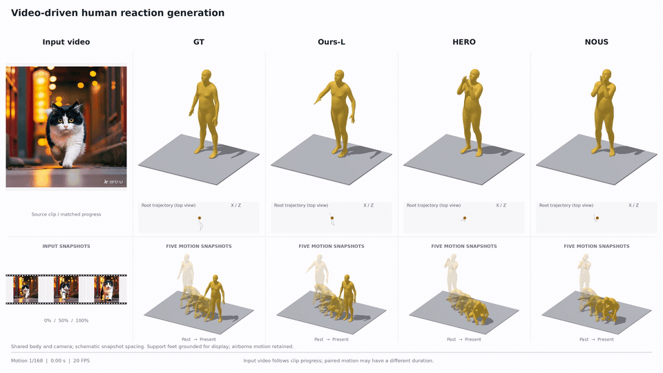

# ReaDiff

ReaDiff generates a 3D human reaction from an RGB video. Choose S, M or L to use the corresponding ViMo checkpoint. Each generates a motion sequence at 20 frames per second.

## Motion comparison

The video shows the input clip alongside ground-truth motion and reactions generated by ReaDiff-L (Ours-L), HERO and NOUS.

[](https://cdn.jsdelivr.net/gh/TANGLIDINGZHENG/ReaDiff@main/assets/GT_Ours_HERO_NOUS_comparison_1080p.mp4)

[Watch the full comparison in 1080p (2 min 26 s)](https://cdn.jsdelivr.net/gh/TANGLIDINGZHENG/ReaDiff@main/assets/GT_Ours_HERO_NOUS_comparison_1080p.mp4) · [Download MP4](https://raw.githubusercontent.com/TANGLIDINGZHENG/ReaDiff/main/assets/GT_Ours_HERO_NOUS_comparison_1080p.mp4)

## Install

The reference environment uses Linux x86-64, Python 3.10 and PyTorch 2.12.1. The following commands select the CUDA 13.0 build used for the reference runs.

```bash
python3.10 -m venv .venv
source .venv/bin/activate
python -m pip install torch==2.12.1 --index-url https://download.pytorch.org/whl/cu130
python -m pip install -r requirements.txt
```

## Weights

In GitHub Releases, download `ReaDiff-shared.safetensors` and the model file for the size you want. Place both in `weights/`. The shared file contains the TC-CLIP visual encoder, the RVQ motion decoder and the motion normalization statistics.

From a clone of this repository, the GitHub CLI can download and verify the two files for ReaDiff-S.

```bash
mkdir -p weights
gh release download v1.0.0 -D weights -p 'ReaDiff-shared.safetensors' -p 'ReaDiff-S.safetensors'
sha256sum --check --ignore-missing SHA256SUMS
```

## Generate a motion

```bash
python infer.py --model S --video input.mp4 --frames 88 --seed 10107 --device cuda:0 --output outputs
```

Use `--model M` or `--model L` with its matching weight file. The output length can be any multiple of four from 4 through 200 frames. A different seed samples another reaction for the same video. Each configuration includes the exact 50 UniPC timesteps and guidance settings used in the archived evaluation.

| Output suffix | Shape | Contents |
| --- | --- | --- |
| `_joints.npy` | (frames, 22, 3) | XYZ joint positions in ViMo motion coordinates, with Y up |
| `_motion.npy` | (frames, 263) | Denormalized per-frame motion features in the ViMo representation |

## ViMo results

The entries below come from the archived HERO-protocol evaluation on 700 ViMo test videos. Each interval is the 95% confidence half-width over 20 sampling repeats for one trained checkpoint. Checkpoint and sampler selection used the test split. The configuration files record the source checkpoint SHA-256, architecture and full-precision metrics.

| Model | Generator parameters | Epoch | FID ↓ | Diversity | Multimodality |
| --- | ---: | ---: | ---: | ---: | ---: |
| [ReaDiff-S](configs/ReaDiff-S.json) | 35,297,880 | 190 | 0.30511 ± 0.01242 | 8.09988 ± 0.08597 | 2.53445 ± 0.06532 |
| [ReaDiff-M](configs/ReaDiff-M.json) | 67,581,918 | 190 | 0.28754 ± 0.01130 | 8.13846 ± 0.07601 | 2.32756 ± 0.06145 |
| [ReaDiff-L](configs/ReaDiff-L.json) | 182,529,258 | 200 | 0.25170 ± 0.00935 | 8.08236 ± 0.07550 | 2.39883 ± 0.05992 |

The model sizes correspond to archive labels L, XL and XXXL respectively. On a ViMo high-five clip, the standalone entry point and the original inference pipeline produced identical motion and joint arrays for all three sizes at 88 frames and seed 10107 on RTX PRO 6000 Blackwell GPUs.

## Credits

The visual encoder and motion decoder use the pretrained weights distributed with HERO. The source includes adapted components from TC-CLIP, ToMe, OpenAI CLIP, QuaterNet and UniPC. See the [source credits and license notices](NOTICE.md).
